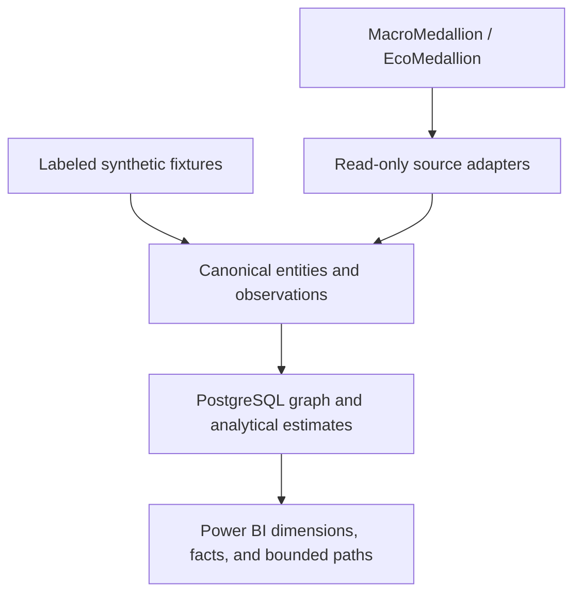

# MarketAtlas

**A temporal market knowledge graph connecting instruments, macro data, and measurable relationships through PostgreSQL and Power BI.**

Status: early implementation. The deterministic fixture contract, bounded MacroMedallion PostgreSQL adapter, identity/ontology graph, temporal assertion replay, versioned synthetic observation loading, curated macro-context mappings, bounded rolling correlations, atomic fixture publication, contributor walkthrough, and handoff design work. Power BI remains planned.

MarketAtlas gives market data a relationship layer. Start with a security, issuer, currency, country, index, or economic series; follow the links; inspect the source and the date each link was known. Compare those sourced relationships with time-bounded statistical estimates without treating correlation as causality.

The project consumes verified MacroMedallion PostgreSQL outputs through small read-only adapters and uses dedicated PostgreSQL schemas for graph storage and reporting views. Josh owns the local restricted-use pilot across source/data, database, report, methodology, refresh/recovery, and incident roles. No external redistribution is authorized.

**Resuming work later?** Start with [the next-session checkpoint](docs/handoff.md#start-here-next-session)
for the merged baseline, validation evidence, exact next task and a ready-to-paste
prompt for the next agent.

## The first demonstration

A reviewer should be able to select a fixture instrument, follow its issuer and classifications, inspect the evidence for a macro context link, and examine how a rolling correlation changed across selected dates. Every statistical edge should show its transformation, sample size, window, and data cutoff.

| Question | Planned output |
| --- | --- |
| What connects this instrument to an issuer, sector, currency, or country? | A bounded relationship path with provenance |
| Why is a macro series shown alongside this market? | A sourced or explicitly curated context mapping |
| Has a relationship changed? | Rolling correlation estimates and quality diagnostics |
| Could this have been known at the time? | Effective dates, availability timestamps, and vintage information |

The portable demonstration will use clearly labeled synthetic fixtures. Authorized upstream integrations are optional. Real historical results require suitable data rights and verified availability/vintage history.

## Planned architecture



Reference facts and calculated estimates have distinct semantics. PostgreSQL prepares the relationships and reporting outputs. Power BI presents filtered views, paths, and time series using explicit row grains.

## Source access and browser boundary

MacroMedallion and EcoMedallion are interchangeable names for the same optional
local upstream asset. They are **not** browser data sources. The React demo and
any future browser client must never receive PostgreSQL credentials or query
`macro_medallion` source schemas directly.

```text
Browser → MarketAtlas server/report API → snapshot-pinned atlas_report views
MarketAtlas source-contract service → read-only macro_medallion schemas
```

The scoped `marketatlas_source_reader` role can catalog and perform zero-row
read probes on the approved economic source surface. In the current local
catalog, 91 economic objects are readable. Six are approved as
`supported_live`: `meta.fred_series`, `gold.fred_point_in_time`,
`gold.dim_series`, `gold.release_calendar`, `gold.v_source_coverage`, and
`gold.v_series_revision_summary`. The other 85 readable objects are
`discovered_not_onboarded`: visibility or
database permission is not permission to ingest, expose, or redistribute them.

An object becomes `supported_live` only after owner and rights review, a declared
grain/business key and temporal semantics, required-column and schema-drift
checks, a bounded adapter, manifest lineage, and validation evidence. Browser
clients receive only explicitly selected, snapshot-pinned reporting fields from
`atlas_report`; they do not receive raw source tables. See the
[source catalog](docs/source-catalog.md) for the promotion rule and current
support states.

## Working slices

The repository has a standard-library Python CLI for generating and validating deterministic **synthetic inputs**. It also has an optional PostgreSQL adapter for verified MacroMedallion series metadata and point-in-time observations, versioned fixture loading into the dedicated `atlas` schema, a bounded rolling-correlation fixture calculator, and an atomic fixture-serving publication. A source-controlled Power BI semantic-model template exists, but no Power BI report has yet been exercised. Python 3.11 or newer is required.

For the exercised credential-free contributor path, follow [the contributor
demo walkthrough](docs/contributor-demo.md). It needs no database or local
configuration and explicitly labels every input synthetic. The commands below
are the same fixture contract path:

```bash
PYTHONPATH=src python -m market_atlas fixture build --output /tmp/marketatlas-fixture
PYTHONPATH=src python -m market_atlas fixture validate --input /tmp/marketatlas-fixture
PYTHONPATH=src python -m market_atlas fixture inspect --knowledge-cutoff 2024-02-10T00:00:00Z
PYTHONPATH=src python -m unittest discover -s tests -v
```

For local PostgreSQL integration, copy `configs/local.example.toml` to the git-ignored `configs/local.toml`, fill in the connection values, install `requirements.lock`, and run:

```bash
PYTHONPATH=src python -m market_atlas database inspect --output data/generated/macro_medallion_schema.json
PYTHONPATH=src python -m market_atlas database migrate
PYTHONPATH=src python -m market_atlas database validate-roles
PYTHONPATH=src python -m market_atlas database catalog --output data/generated/source_catalog.json
PYTHONPATH=src python -m market_atlas database verify-contracts --catalog data/generated/source_catalog.json
PYTHONPATH=src python -m market_atlas adapter verify
PYTHONPATH=src python -m market_atlas adapter extract --output data/generated/macro_medallion_pilot.json
PYTHONPATH=src python -m market_atlas adapter verify-context
PYTHONPATH=src python -m market_atlas adapter extract-context --output data/generated/macro_context_pilot.json
PYTHONPATH=src python -m market_atlas adapter verify-revision-summary
# Revision quality is configured-ID only; it does not scan the full aggregate view.
PYTHONPATH=src python -m market_atlas adapter extract-revision-summary --output data/generated/revision_summary_catalog.json
PYTHONPATH=src python -m market_atlas adapter ingest --pilot-config configs/pilot.toml
PYTHONPATH=src python -m market_atlas context publish --input data/generated/macro_context_pilot.json
PYTHONPATH=src python -m market_atlas context validate --input data/generated/macro_context_pilot.json
PYTHONPATH=src python -m market_atlas economic-graph publish --input data/generated/macro_context_pilot.json
# Full approved-series catalog: taxonomy only by default; coverage is opt-in and bounded.
PYTHONPATH=src python -m market_atlas adapter extract-series-catalog --output data/generated/macro_series_catalog.json
PYTHONPATH=src python -m market_atlas economic-graph publish --input data/generated/macro_series_catalog.json
PYTHONPATH=src python -m market_atlas revision-quality publish --input data/generated/revision_summary_catalog.json
PYTHONPATH=src python -m market_atlas report serve-macro-economic-graph
PYTHONPATH=src python -m market_atlas release validate --samples 20 --output data/generated/t013_release_validation.json
PYTHONPATH=src python -m market_atlas graph validate-fixture
PYTHONPATH=src python -m market_atlas graph validate-temporal-fixture
PYTHONPATH=src python -m market_atlas graph validate-observation-fixture
PYTHONPATH=src python -m market_atlas graph validate-curated-context-fixture
PYTHONPATH=src python -m market_atlas analytics validate-fixture
PYTHONPATH=src python -m market_atlas build validate-fixture
PYTHONPATH=src python -m market_atlas report validate-fixture
```

The independent [React demo](frontend/README.md) uses the QuantMeridian-style Vite scaffold and renders a labeled fixture snapshot through the T-011 reporting contract. It never connects browser code to PostgreSQL. Run it with `cd frontend && npm install && npm run dev`.

After the local report API is running, the demo's **Live macro graph** mode uses Vite's local `/api` proxy to request only the snapshot-pinned `macro_economic_graph` publication. The default graph is a catalog hub plus economic-category navigation summaries; selecting a category returns a paged, searchable neighborhood of actual source-backed `macro series → measures → economic concept` assertions. The interactive canvas intentionally shows 12 series per page to keep nodes and links legible; the API itself stays separately bounded at 1–100 rows and is performance-tested at 50 rows. Summary `contains` links are visibly labeled as navigation only, not assertions. The UI labels taxonomy as `current_only`; it is not point-in-time taxonomy history, a sensitivity estimate, or a browser-to-database connection.

`extract-series-catalog` reads every approved `gold.dim_series` record through the contract gate. It omits `gold.v_source_coverage` by default because full-view scans can be costly; pass `--include-coverage` only after confirming a bounded source workload. This distinction is retained in the manifest as `not_selected`, rather than being represented as missing or historical data.

`extract-revision-summary` validates explicitly configured IDs against
`gold.dim_series` and reads current quality summaries in batches of at most
1,000 IDs. Missing summaries are explicit unknowns. It never scans the
20.5-million-row revision-history table or claims point-in-time reconstruction.

T-017 publishes that bounded extract separately as `macro_revision_quality`.
Select a macro-series node in **Live macro graph** to see current quality context,
capture time and expandable snapshot/input/build provenance. Missing summaries
are unknown with null metrics; series outside the selection are labeled
separately. The quality publication has its own snapshot and capture time,
independent of graph taxonomy. Results remain restricted internal context with
unsupported historical availability. See the
[T-017 validation](reports/t017-revision-quality-publication-validation.md).

Source connections force `default_transaction_read_only=on` and switch to the NOLOGIN `marketatlas_source_reader` role. Migrations switch to `marketatlas_writer`; report consumers use `marketatlas_report_reader`. Generated inspection and extract files are ignored. The source-reader migration grants read access to the explicitly named economic schemas for metadata discovery, but adapters may use only `supported_live` objects that pass the source-contract gate; it never changes source objects or grants source-write access.

The fixture manifest records record counts, a SHA-256 hash, and the explicit status `graph_and_report_not_built`. The database loader records a reproducible `input_manifest` for the same fixture hash and structured source-backed/curated context mappings. The macro-context publisher separately persists current source taxonomy and coverage plus scheduled release events, then exposes only the immutable `atlas_report.current_macro_source_context` publication; it does not recast current source attributes as point-in-time history. [Fixture contract](docs/fixtures.md) describes the grains and edge cases. [Source discovery](reports/discovery.md) records the verified PostgreSQL contract and remaining gaps. [Acceptance evidence](docs/acceptance.md) records fixture evidence and the remaining partial or pending checks.

The metadata-only [source catalog](docs/source-catalog.md) inventories every local upstream relation/view and assigns an explicit support state. The tracked [source-contract registry](contracts/source_contracts.toml) declares the required schema, ownership, temporal semantics, rights status, adapter, and fingerprints for the approved interfaces; `database verify-contracts` blocks activation on drift or missing metadata. Neither artifact authorizes or ingests an object merely because it appears in the catalog.

## Delivery documents

Read in order:

1. [Specification](docs/spec.md): user questions, scope, requirements, and acceptance criteria.
2. [Implementation plan](docs/plan.md): architecture, contracts, build order, and requirement coverage.
3. [Tasks](docs/tasks.md): dependencies, owners, completion evidence, and acceptance mapping.
4. [Handoff](docs/handoff.md): current state, completed handoff, integration questions, and operating expectations.
5. [Roadmap](docs/roadmap.md): capability milestones and the securities-finance extension.
6. [Review and traceability](docs/review.md): changes from the original spec and the requirement-to-task map.
7. [Acceptance evidence register](docs/acceptance.md): the 18 implementation checks and their passed, partial or pending scope.
8. [Naming notes](docs/naming.md): repository name, alternatives, and positioning.
9. [Frontend scaffold decision](docs/decisions/001-quantmeridian-react-scaffold.md): QuantMeridian-based React demo architecture and boundaries.
10. [Reporting contract](docs/reporting.md): snapshot-pinned dimensions, facts, paths, and provenance drill-through.
11. [React demo validation](reports/t012-validation.md): frontend scope, build evidence, and known dependency/security follow-up.
12. [Source catalog](docs/source-catalog.md): local relation/view inventory and object-promotion rules.
13. [Contributor demo](docs/contributor-demo.md): exercised clean-room fixture and browser walkthrough.
14. [Operations handoff](docs/operations.md): manual refresh and controlled recovery posture.
15. [Data and license notice](docs/data-and-license-notice.md): code license versus source-data rights.
16. [Securities-finance extension contract](docs/securities-finance-extension.md): future restricted-domain boundary.
17. [Power BI source package](powerbi/README.md): pinned-snapshot semantic-model template and required in-product reconciliation.
18. [Power BI data jobs](powerbi/guides/data-jobs.md): reproducible CSV packs, report-only internal exports, Power Query loading, and a synthetic GitHub artifact job.
19. [Power BI report recipes](powerbi/guides/report-recipes.md): compelling report questions, model relationships, DAX, visual layouts, and reconciliation checks.
20. [PostgreSQL publication access](docs/publication-access.md): browse all four named report snapshots, their views, and reader access.
21. [Dagster refresh jobs](docs/dagster-orchestration.md): rolling daily PostgreSQL refreshes, run checkpoints, local UI, schedule activation, and deployment limits.

22. [Generated reports](powerbi/guides/generated-reports.md): editable Power BI projects plus a local actual-data browser report that needs no Power BI account.

23. [Report front-end runbook](docs/report-frontend-runbook.md): open/start/stop the local report, recover after reboot, and rebuild from a new data pack.

The individual documents are canonical. Preserve requirement IDs when revising scope so the plan, tasks, and acceptance evidence stay aligned.

## Extending to securities finance

The later domain layer can reuse stable instrument IDs to relate restricted agreement rules, collateral eligibility, borrower/lender relationships, and exception dependencies. A public example will remain synthetic. Restricted client/trade facts must stay in a separately authorized deployment and cannot be exposed through `atlas_report` or the browser API. See the [extension contract](docs/securities-finance-extension.md).

## Portfolio presentation

Repository: [thatquantguy44/MarketAtlas](https://github.com/thatquantguy44/MarketAtlas).

Suggested repository description:

> Temporal market knowledge graphs in PostgreSQL: connect macro data, instruments, and statistical relationships, with provenance and Power BI views.

Suggested topics: `knowledge-graph`, `market-data`, `macroeconomics`, `quantitative-finance`, `postgresql`, `python`, `powerbi`, `data-lineage`, `point-in-time`.

The T-014 task retained actual local screenshot evidence and an exercised clean-room walkthrough; see [the handoff report](reports/t014-contributor-handoff.md). Screenshots, tests, and performance badges should describe work that actually exists. The project uses the [MIT License](LICENSE). Data sources and redistributed datasets require their own usage and redistribution review; see the [data and license notice](docs/data-and-license-notice.md).
