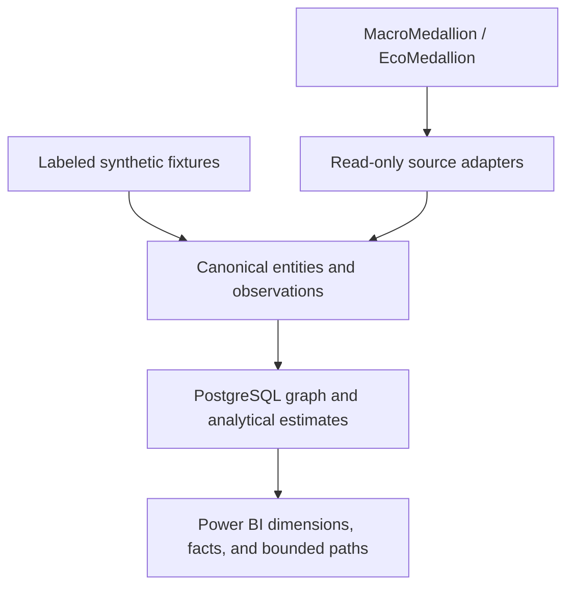

# MarketAtlas

**A temporal market knowledge graph connecting instruments, macro data, and measurable relationships through PostgreSQL and Power BI.**

Status: design stage. This repository contains the specification and delivery documents. The graph implementation, source integrations, and Power BI report are planned.

MarketAtlas gives market data a relationship layer. Start with a security, issuer, currency, country, index, or economic series; follow the links; inspect the source and the date each link was known. Compare those sourced relationships with time-bounded statistical estimates without treating correlation as causality.

The project is designed to consume existing MacroMedallion / EcoMedallion outputs through small adapters and use PostgreSQL for graph storage and reporting views. Their exact repository identities, schemas, and reusable components must be established during discovery.

## The first demonstration

A reviewer should be able to select a fixture instrument, follow its issuer and classifications, inspect the evidence for a macro context link, and examine how a rolling correlation changed across selected dates. Every statistical edge should show its transformation, sample size, window, and data cutoff.

| Question | Planned output |
| --- | --- |
| What connects this instrument to an issuer, sector, currency, or country? | A bounded relationship path with provenance |
| Why is a macro series shown alongside this market? | A sourced or explicitly curated context mapping |
| Has a relationship changed? | Rolling correlation estimates and quality diagnostics |
| Could this have been known at the time? | Effective dates, availability timestamps, and vintage information |

The portable demonstration will use clearly labeled synthetic fixtures. Authorized upstream integrations are optional. Real historical results require suitable data rights and verified availability/vintage history.

## Planned architecture



Reference facts and calculated estimates have distinct semantics. PostgreSQL prepares the relationships and reporting outputs. Power BI presents filtered views, paths, and time series using explicit row grains.

## First working slice: synthetic fixture contract

The repository now has a standard-library Python CLI for generating and validating deterministic **synthetic inputs**. It does not yet load PostgreSQL, calculate rolling correlations, or create a Power BI report. Python 3.11 or newer is required; runtime dependencies are empty in `requirements.lock`.

```bash
PYTHONPATH=src python -m market_atlas fixture build --output /tmp/marketatlas-fixture
PYTHONPATH=src python -m market_atlas fixture validate --input /tmp/marketatlas-fixture
PYTHONPATH=src python -m market_atlas fixture inspect --knowledge-cutoff 2024-02-10T00:00:00Z
PYTHONPATH=src python -m unittest discover -s tests -v
```

The fixture manifest records record counts, a SHA-256 hash, and the explicit status `graph_and_report_not_built`. [Fixture contract](docs/fixtures.md) describes the grains and edge cases. [Initial discovery](reports/discovery.md) records what was verified about EcoMedallion and what still needs authorized database inspection. All implementation acceptance criteria remain pending.

## Delivery documents

Read in order:

1. [Specification](docs/spec.md): user questions, scope, requirements, and acceptance criteria.
2. [Implementation plan](docs/plan.md): architecture, contracts, build order, and requirement coverage.
3. [Tasks](docs/tasks.md): dependencies, owners, completion evidence, and acceptance mapping.
4. [Handoff](docs/handoff.md): current state, next action, integration questions, and operating expectations.
5. [Roadmap](docs/roadmap.md): capability milestones and the securities-finance extension.
6. [Review and traceability](docs/review.md): changes from the original spec and the requirement-to-task map.
7. [Acceptance evidence register](docs/acceptance.md): the 18 implementation checks, currently pending.
8. [Naming notes](docs/naming.md): repository name, alternatives, and positioning.

The individual documents are canonical. Preserve requirement IDs when revising scope so the plan, tasks, and acceptance evidence stay aligned.

## Extending to securities finance

The later domain layer can reuse instruments, issuers, countries, currencies, and markets to add agreement rules, collateral eligibility, borrower/lender relationships, and exception dependencies. A public example will remain synthetic. Any internal integration requires an authorized environment and domain-specific data contracts.

## Portfolio presentation

Repository: [thatquantguy44/MarketAtlas](https://github.com/thatquantguy44/MarketAtlas).

Suggested repository description:

> Temporal market knowledge graphs in PostgreSQL: connect macro data, instruments, and statistical relationships, with provenance and Power BI views.

Suggested topics: `knowledge-graph`, `market-data`, `macroeconomics`, `quantitative-finance`, `postgresql`, `python`, `powerbi`, `data-lineage`, `point-in-time`.

Before pinning an implemented release, add a real demo screenshot, a short reproducible walkthrough, and the measured release evidence. Screenshots, tests, and performance badges should describe work that actually exists. The project uses the [MIT License](LICENSE). Data sources and redistributed datasets require their own usage and redistribution review.
