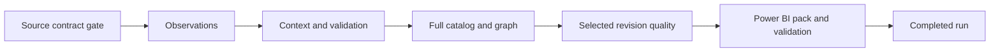

# Daily PostgreSQL → MarketAtlas refresh

The optional Dagster runtime refreshes MarketAtlas from its six approved
PostgreSQL source interfaces. It does not launch upstream FRED/EcoMedallion API
ingestion. The user selected PostgreSQL-only orchestration. Source reads use
`marketatlas_source_reader`, graph writes use `marketatlas_writer`, and exports
use `marketatlas_report_reader`.

## Jobs and dependencies

`fred_daily_refresh` runs these 13 ordered operations:

1. `source_gate` — verify the source contract registry and optional upstream
   success marker.
2. `extract_observations` — capture the configured FRED observation versions
   through the run date.
3. `ingest_observations` — load versioned observations into MarketAtlas.
4. `extract_context` — capture metadata/source notes, scheduled releases and
   coverage for the configured series.
5. `publish_context` — publish an immutable `macro_context` snapshot.
6. `validate_context` — reconcile the context publication with its extract.
7. `extract_catalog` — capture the full approved series taxonomy without a full
   coverage-view scan.
8. `publish_graph` — publish the full `macro_economic_graph` nodes/edges.
9. `extract_quality` — capture summaries for the configured selected series.
10. `publish_quality` — publish independent `macro_revision_quality` data.
11. `export_powerbi` — export only these three real-data publications.
12. `validate_powerbi` — verify schemas, checksums, grains, snapshots and coverage.
13. `complete_refresh` — record the completed run and pack identity.



`synthetic_powerbi_smoke` is a separate two-operation job that generates and
validates a synthetic CSV pack with no database connection. No daily job rebuilds
or republishes `synthetic_fixture`.

## Start the local runtime

From the repository root, using Python 3.12:

```sh
python3 -m venv .venv-dagster
.venv-dagster/bin/python -m pip install -r requirements-orchestration.lock
.venv-dagster/bin/python -m pip check
./scripts/dagster-dev.sh
```

Skip environment creation/installation when using the environment already
prepared for this work. The optional packages are pinned to Dagster and webserver
1.13.27; the lock also pins the resolved dependencies. Core fixture use remains
standard-library-only. The `orchestration` optional dependency group in
`pyproject.toml` is available for other installation workflows.

The launcher starts the private local development webserver and daemon at
**http://127.0.0.1:3001**, with state in ignored `.dagster/`. Do not start a second
copy on the same port. Open **Jobs → fred_daily_refresh → Launchpad** to run it,
or inspect the retained successful run. The example run configuration is [orchestration/refresh-run.yaml](../orchestration/refresh-run.yaml).
No password or connection string belongs in Dagster run configuration.

This development process must remain running for scheduling. It is not an
installed operating-system service, and does not automatically recover from
sleep, reboot or a terminated terminal. A production deployment needs a stable
host, protected metadata storage/backups, access control and independent daemon
monitoring.

## Daily schedule and rolling windows

The `fred_daily_schedule` definition is **18:30 America/New_York, every day**.
It is initially stopped. Enable it in Dagster's schedule view when you want
recurring runs; inspect the first tick/run there. The scheduler uses the tick's
New York calendar date, including across daylight-saving changes.

[configs/orchestration.toml](../configs/orchestration.toml) configures the cron,
timezone, output locations, release window, batch size and export row limit.
To customize locally, copy it to ignored `configs/orchestration.local.toml` and
set `MARKETATLAS_PIPELINE_SETTINGS=configs/orchestration.local.toml` before
starting Dagster. `MARKETATLAS_CONFIG` optionally selects the private database
configuration file. Restart/reload the code location after changing settings.

At run preparation, the pipeline computes one immutable plan:

- Observation end date and knowledge cutoff become the run date. The configured
  history start and selected series remain unchanged.
- Release dates span run date minus 7 days through run date plus 60 days by
  default. The old fixed October–December window is not used by this job.
- The selected observation/context/quality series remain `CPIAUCSL`, `GDP` and
  `UNRATE`, controlled by the existing pilot configuration files.
- Graph publication uses the full approved catalog, not the three-series sample.

An `as_of` override changes the selection windows; it does not reconstruct
historical taxonomy or historical revision summaries. Those captures remain
explicitly current context. Future run dates are rejected.

## Preview or execute without the UI

A preview reads configuration, prints the plan and writes no files:

```sh
PYTHONPATH=src python3 -S -m market_atlas refresh plan
```

The same execution service is available without Dagster, using PostgreSQL support:

```sh
PYTHONPATH=src .venv-dagster/bin/python -m market_atlas refresh run
```

This standalone route writes the same private checkpoint records and acquires
the same database lock, but has no Dagster run history or automatic op retries.
Use a fresh run ID for each invocation. An existing run directory is never
silently reused or overwritten. Dagster re-execution creates a new run; automatic
op retries within the same run reuse the already captured extract.

## Credentials, freshness and run artifacts

Store connection values only in ignored `configs/local.toml`. A configured
`[report_database]` profile is preferred. If absent, this pipeline uses the
existing target login for exports and explicitly assumes the report-reader
role in a read-only transaction; it does not create a login or copy credentials
into files. The source profile must explicitly select the source-reader role.

No upstream success marker is required in PostgreSQL-only mode. The checkpoint
then records `upstream_freshness = "not_verified"`. A successful graph capture
therefore does not prove that the upstream FRED API job ran today. If needed,
set `upstream_success_file` to an existing local marker containing:

```json
{"status":"success","completed_at":"2026-10-30T21:00:00Z"}
```

The upstream owner should remove the marker when starting ingestion and write
it atomically after a successful completion. The gate rejects failed, missing,
future, timezone-free or stale markers (36-hour limit by default). MarketAtlas
never writes that upstream marker or modifies the upstream repository.

Each run writes to ignored `data/generated/daily/<run-id>/`:

- `plan.json` fixes the dates and selections.
- `contract_gate.json`, observation/context/catalog/quality JSON files retain
  the captured inputs privately.
- `run.json` records stage order, attempts, safe errors, snapshot IDs and counts.
- `export.json` points to the immutable validated Power BI pack under
  `data/generated/powerbi-real/<pack-id>/`.

Private source rows stay in these ignored inputs and packs. Dagster receives
only stage/status metadata; passwords and raw driver errors are not emitted.
Source `notes` are copied as metadata during taxonomy ingestion. They are not
newly authored research notes; the graph report payload still uses its bounded
field contract, and published context notes cover the selected series.

## Concurrency, failures and Power BI

The instance template allows one queued run at a time. A PostgreSQL advisory
lock also excludes overlapping refresh jobs/standalone runners against the same
database. The job uses in-process execution so the lock session spans all stages.
Do not run separate manual publishers concurrently with the daily job; those
older commands do not participate in this orchestration lock.

Transient database/I/O failures receive up to two Dagster retries with a two-second
delay. Validation failures stop downstream stages immediately. The failed stage
and error class are recorded without raw values. Earlier successfully published
surfaces may remain updated: each publication is atomic independently, not the
whole 13-stage job. A failed publication retains its prior serving pointer under
the existing publisher contract. A new report pack is handed off only after all
publish stages succeed and pack validation passes.

The pipeline prepares the Power BI data pack; it does not invoke Power BI service
refresh. Select that validated immutable folder as `pPackFolder` and refresh the
report, following [the ingestion guide](../powerbi/guides/data-jobs.md). An automated
service handoff additionally needs a reachable file location/gateway, workspace
and semantic-model configuration; none was configured by this change.

Validation and retained run details: [T-020 evidence](../reports/t020-dagster-orchestration-validation.md).
The implementation uses Dagster's documented [ops](https://docs.dagster.io/api/dagster/ops),
[resources](https://docs.dagster.io/api/dagster/resources) and
[schedules](https://docs.dagster.io/guides/automate/schedules/defining-schedules).
